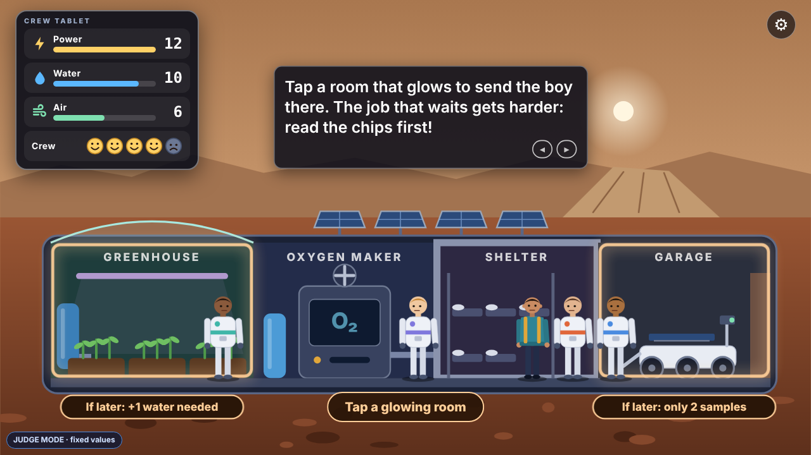
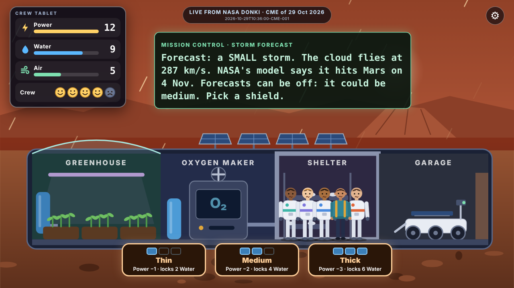
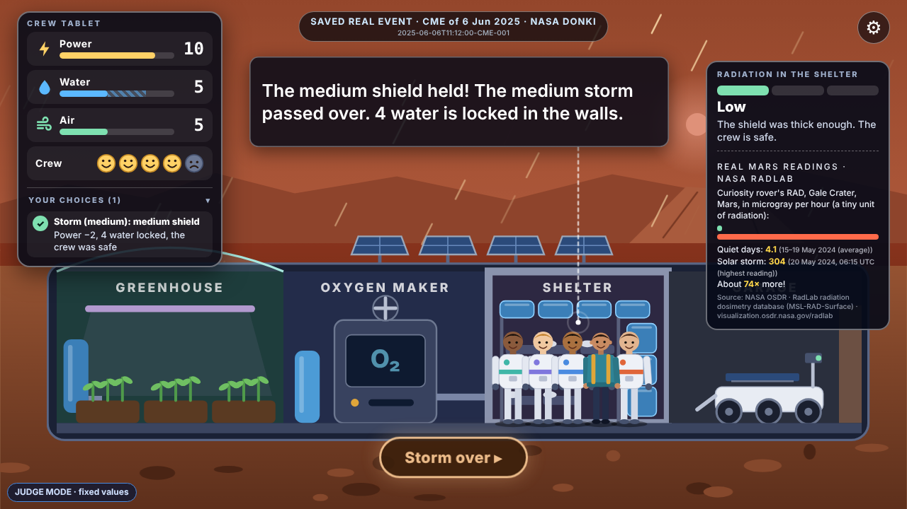
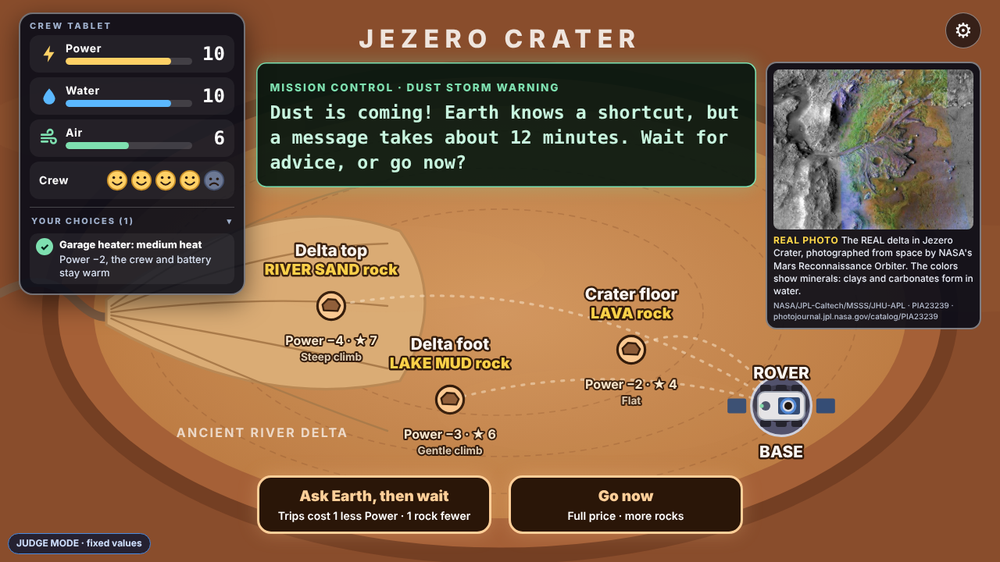

# Mission ARES

**A Mars outpost game for kids 7–12, where every choice costs something, and the storms, the weather and the radio delay come from real NASA data.**

NASA Space Apps Challenge 2026 (Cairo). Challenge: design a game that lets students run a lunar or Martian outpost and feel the trade-offs between life support, radiation shielding, power and food.

▶ **Play:** _add the live link here after deploying_ · For a demo that plays the same every time, add `?judge=1` to the link (Judge Mode).

## The problem

Space content for kids is usually posters and facts: it shows what astronauts do, never *why*. The hard part of a Mars mission is the decisions: power is shared by the air machine, the greenhouse and the rover; water is for drinking, plants **and** radiation walls; a message to Earth takes up to 24 minutes. Kids almost never get to make those decisions themselves.

## Who it helps

- **Kids 7–12:** a browser game, no download, no account, works on a phone held sideways. Short texts in the scene, one at a time, with ◂ ▸ to reread.
- **Teachers and parents:** a 10-minute mission with a recap of every choice, a "Back on Earth" link to real life, and a [teacher guide](TEACHER_GUIDE.md) with discussion questions for each scene.
- **Anyone curious:** every number that comes from NASA is labeled on screen and listed under **NASA data**, so it can be checked.

## How it plays

A boy stows away on a crew of four flying to Jezero Crater. On Mars the Commander hands him the crew tablet: **Power, Water, Air** and the **crew's faces**. Then:

1. **Two jobs, one crew.** The greenhouse or the rover first? The job that waits gets harder (plants need more water; a dust storm means fewer rock samples). Both prices show before you pick.
2. **The job.** Greenhouse: drag water drops and set the lamp; the plants react live (wilted, healthy, lush). Rover: pick a heater for the real Jezero temperature, wait for Earth's advice or go now, and find the rock the science team needs.
3. **The night.** Five people breathe: Air goes down. You connect the oxygen maker's pipes (it uses Power and Water to make Air). At sunrise the solar panels give a little Power back.
4. **The solar storm.** A real eruption on the Sun. Mission Control sends a forecast; you pick a thin, medium or thick water shield. A thicker shield costs more Power and locks more water, but forecasts can be wrong.
5. **The second job**, with what is left. Then a badge (everyone gets one), a recap of every choice, and "Back on Earth" cards.

There is no game over: if a meter would hit zero, an emergency backup saves the crew and costs 3 points.

## The trade-offs (the challenge's five topics)

| Topic | In the game | No free choice |
|---|---|---|
| Life support | The oxygen maker turns 1 Power + 1 Water into 2 Air every night; rover trips use Air | Every rock and every night costs Air |
| Radiation shielding | Thin / medium / thick shield of water tanks | Thicker = more Power now and less water for the plants; too thin = crew −2 per size |
| Power budgeting | Lamp, heater, rover trips, oxygen maker and shield all use Power; only a little comes back at sunrise | Power spent today is not there tomorrow |
| Food production | Water and light for this game's real space crop | Too little wilts (crew −1); more than needed grows a lush harvest but empties the tanks |
| Communication delay | Ask Earth for a shortcut (today's real delay), or go now | Waiting makes trips cheaper but the dust storm allows one rock fewer |

## Real NASA data in the game

| Data | Where it comes from | What it changes in the game | Live or saved |
|---|---|---|---|
| Solar eruptions (CMEs) and their arrival at Mars | **NASA DONKI** (`api.nasa.gov`), with NASA's **WSA-Enlil** model runs stored in DONKI | The cloud's speed sets the storm forecast; the game picks a cloud the model sends to Mars and says when it arrives. The DONKI event ID is shown on screen, and the result screen links to it | **Live** (last 30 days); if NASA is slow or the key is over its limit, one of 3 saved real events (also Mars-bound) |
| Radiation on Mars | **NASA RadLab** (OSDR radiation database): Curiosity's RAD, Gale Crater | The storm's radiation card compares a quiet week (about 4 µGy/h) with the 20 May 2024 storm (304 µGy/h) | Saved (the API query is in `src/storm/radlab.ts`) |
| Space biology | **NASA OSDR** study OSD-268 (lettuce from the ISS Veggie garden tested for germs and nutrients) | Explains why fresh food matters to the crew score | Saved |
| Jezero temperatures | **Perseverance MEDA** weather station (NASA/JPL) | Sets how cold it is; the heater must match it | Saved (5 real readings; there is no public live feed) |
| Earth–Mars distance | **NASA/JPL** approximate planet positions | The real one-way message delay today (about 4–24 min), used for "ask Earth" and for why a storm forecast can come too late | Calculated live from the date |
| Jezero from orbit | **NASA/JPL-Caltech/MSSS/JHU-APL**, Mars Reconnaissance Orbiter, PIA23239 | A real photo of the delta on the rover map | Saved image |
| Space crops | NASA Veggie and Plant Habitat experiments (radishes, lettuce, mizuna, tomatoes, chile peppers) | A different real crop each game, with its real story | Facts |
| Food in remote places | **Canadian Space Agency** food production toolkit (Naurvik Arctic greenhouse) | A "Back on Earth" card | Fact |

**Made up for the game (and labeled that way):** the meter costs, rock points, crew points, badge limits, each crop's water and light needs, and whether a storm turns out one size off its forecast. The full list, with every source, is on the **NASA data** screen in the game (`src/game/sources.ts`).

## Does it work? (evidence)

- **Every choice was checked.** `npm run balance` plays every possible game with the real rules: 540 situations (crop × order × cold × forecast × direct or glancing hit × science-team rock), 1.86 million finished games. Results:
  - Scores run 17–39. The best plan's expected score is at least 31 in every situation, so **Gold (31+) is always reachable**; about 10% of random play gets it. About half of random play reaches Silver (27+).
  - No choice is free: the best plan always matches the heater to the cold (too little now costs the crew too), waits for Earth in about half the situations, and picks a thicker shield than forecast in some.
- **Tests:** `npm test` checks the rules (meters and emergency backups, the night, greenhouse, garage, rover, storm, forecast odds, the Earth–Mars delay, score and badges).
- `npm run build` and `npm run lint` pass.

## Run it

    npm install
    npm run dev        # open the link it prints (http://localhost:5173)
    npm test           # rule tests
    npm run balance    # the balance check
    npm run build      # production build in dist/

**NASA API key:** copy `.env.example` to `.env.local` and put your free key from https://api.nasa.gov in it. `.env.local` is never committed. Without a key the game uses NASA's shared `DEMO_KEY`, which is often rate-limited, so you will mostly see the saved storms. Note: a key in a `VITE_` variable is built into the page; that is normal for a free api.nasa.gov key, which only has a rate limit.

**Judge Mode** (title screen → Settings, or `?judge=1`): the crop, weather, rock, delay and storm are fixed, so a demo always plays the same, and a "Jump to a scene" panel appears. "Skip the story" on the title screen starts at the landing.

**Accessibility:** large in-scene text, adjustable story speed, sound on/off, keyboard play, meters that never rely on color alone, reduced-motion support, landscape phone layout.

## Built with

React 19 + TypeScript + Vite. Every drawing is SVG made in code and every sound is synthesized with the Web Audio API: no image or sound files, except the one NASA photo. Developer notes, how each scene is built and the change log: [CHANGELOG.md](CHANGELOG.md).

## Team

- Fares Mostafa
- Merna Hossam
- Eman Ahmed (github.com/eman383)
- Amr Obaia
- Ahmed Zahran

## AI use

We used Claude, an AI assistant by Anthropic, to help write and review code and text, and to review the project against the judging criteria. Every NASA fact and number is listed with its source in the game's **NASA data** screen and in `src/game/sources.ts`, so it can be checked.
